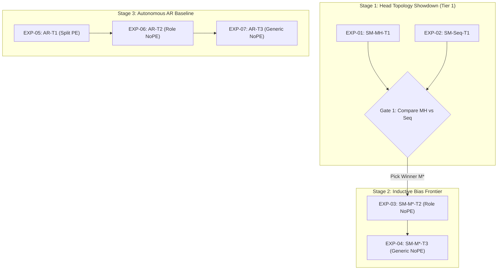

# Primary Architecture Variants & Experiment Sequence

This document specifies the gated, ordered sequence of experiments to run across the TransformAdder design space.

---

## 1. Gated Execution Pipeline

---

## 2. Ordered Sequence of Primary Experiments

| Order | Variant ID | Mechanic | Tier | $N_{\text{layers}}$ | FFN | Attention | Training Bases | Decision / Purpose |
| :---: | :--- | :--- | :--- | :---: | :--- | :--- | :--- | :--- |
| **1** | `SM-MH-T1-L6-SwiGLU-Causal` | SM-MH | T1 (Split PE) | 6 | SwiGLU | Causal | $\{2, 4, 8, 10\}$ | Head showdown: parallel linear projection heads. |
| **2** | `SM-Seq-T1-L6-SwiGLU-Causal` | SM-Seq | T1 (Split PE) | 6 | SwiGLU | Causal | $\{2, 4, 8, 10\}$ | Head showdown: unified single-head copy circuit. |
| — | **GATE 1 EVALUATION** | — | — | — | — | — | — | **Compare EXP-01 vs EXP-02. Select winner $M^*$ for Stage 2.** |
| **3** | `SM-[M*]-T2-L6-SwiGLU-Causal` | $M^*$ | T2 (Role NoPE) | 6 | SwiGLU | Causal | $\{2, 4, 8, 10\}$ | Inductive bias step: evaluate winner under Role NoPE. |
| **4** | `SM-[M*]-T3-L6-SwiGLU-Causal` | $M^*$ | T3 (Generic NoPE) | 6 | SwiGLU | Causal | $\{2, 4, 8, 10\}$ | Hardest SM frontier: evaluate winner under Generic NoPE. |
| **5** | `AR-T1-L6-SwiGLU-Causal` | AR | T1 (Split PE) | 6 | SwiGLU | Causal | $\{2, 4, 8, 10\}$ | AR baseline: autonomous trace with explicit PE. |
| **6** | `AR-T2-L6-SwiGLU-Causal` | AR | T2 (Role NoPE) | 6 | SwiGLU | Causal | $\{2, 4, 8, 10\}$ | AR baseline: autonomous trace with role delimiters. |
| **7** | `AR-T3-L6-SwiGLU-Causal` | AR | T3 (Generic NoPE) | 6 | SwiGLU | Causal | $\{2, 4, 8, 10\}$ | Ultimate frontier: fully emergent autonomous trace. |
| **8** | `SM-[M*]-T1-L2-SwiGLU-Causal` | $M^*$ | T1 (Split PE) | 2 | SwiGLU | Causal | $\{2, 4, 8, 10\}$ | Depth lever: 2-layer circuit compression hypothesis. |
| **9** | `AR-T3-L3-SwiGLU-Causal` | AR | T3 (Generic NoPE) | 3 | SwiGLU | Causal | $\{2, 4, 8, 10\}$ | Depth lever: 3-layer algorithmic decomposition bound. |
| **10** | `SM-[M*]-T1-L6-GELU-Causal` | $M^*$ | T1 (Split PE) | 6 | GELU | Causal | $\{2, 4, 8, 10\}$ | Non-linearity lever: standard MLP vs gated SwiGLU. |
| **11** | `SM-[M*]-T1-L6-SwiGLU-Causal-Base10` | $M^*$ | T1 (Split PE) | 6 | SwiGLU | Causal | $\{10\}$ | Base curriculum control: single-base memorisation baseline. |

---

## 3. Combinatorial Expansion Placeholders

| Set ID | Sweep Dimension | Fixed Settings | Varied Parameters | Scope Placeholder |
| :--- | :--- | :--- | :--- | :--- |
| `GRID-RUNNER-UP` | Runner-Up Head Model | Tier 2 & 3 ($L=6$, SwiGLU, Causal) | Eliminated head mechanic | Confirmatory run of the eliminated head from Gate 1. |
| `GRID-DEPTH` | Model Depth ($N_{\text{layers}}$) | Variants 1, 3, 7 ($d=512$, SwiGLU) | $N \in \{1, 4, 8, 12\}$ | Full depth scaling sweeps across primary paradigms. |
| `GRID-PREFIX` | Visibility Regime | Variant 1 ($L=6$, SwiGLU) | Prefix-LM vs Strict Causal | Prefix-LM evaluation on Tier 1 only; invalid under NoPE ([`03_levers.md`](03_levers.md) Section 6). |
| `GRID-ACT` | Non-Linearity | Variants 3, 7 ($L=6$, Causal) | FFN $\in \{\text{ReLU}, \text{Squared ReLU}, \text{GELU}\}$ | Activation function comparison across primary models. |
| `GRID-CURR` | Curriculum Diversity | Variants 1, 7 ($L=6$, SwiGLU) | $\mathcal{B} \in \{\{2\}, \{2, 8\}, \{2, 3, 4, 5, 8, 10, 12, 16\}\}$ | Curriculum size and granularity ablation sweeps. |
