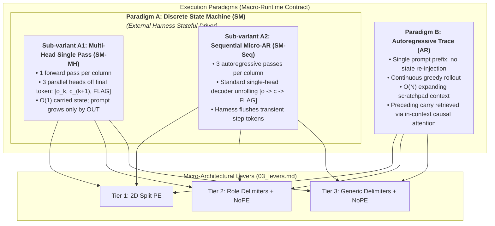

# Execution Mechanics: State Transitions & Runtime Paradigms

This document formalises the **runtime execution mechanics** of TransformAdder. It defines the contract between the neural network and the runtime execution harness, establishing two operational paradigms: the **Iterative Discrete State Machine (`SM`)** and the **Continuous Autoregressive Trace (`AR`)**.

Notation ($\mathcal{A}$, $a_k$, $c_k$, $o_k$, $K$, $OUT_k$, $\text{FLAG}_k$) and token display aliases (`[S]`, `[C]`, `[F]`, `[OUT]`, `|`, …) follow [`README.md`](README.md). Byte assignments are defined in [`03_levers.md`](03_levers.md) Section 2.1.

---

## 1. Executive Summary & Paradigm Taxonomy

The core research question asks whether a transformer can learn base-conditioned arithmetic zero-shot from an in-context axiom. However, executing multi-digit addition requires managing intermediate states (column indices and carry values) across successive steps.

We decouple the **runtime execution contract** (how computation is rolled out across time) from the **micro-architectural levers** (positional encodings, embedding tables, FFN non-linearities, and layer depth defined in [`03_levers.md`](03_levers.md)).



---

## 2. Shared Algorithmic & Symbolic Foundations

Both paradigms adhere strictly to the following foundational invariants:

1. **Axiom-Defined Numeral System**:
   The active numeral system is defined in context by an ordered alphabet sequence:
   $$\mathcal{A} = [s_0, s_1, \dots, s_{B-1}], \quad \text{where } s_i \in \Sigma = \mathcal{V} \setminus \mathcal{V}_{\text{ctrl}} \text{ and } \text{val}(s_i) = i$$
2. **Algorithmic Reading Order ($LSD \to MSD$)**:
   Operands $a$, $b$, and the accumulated result $OUT$ are formatted strictly in least-significant-digit-first order. Coordinate or offset 0 is invariantly the least significant digit, decoupling column alignment from total operand length.
3. **Missing Operand Identity**:
   Operands are unpadded. When column index $k \ge \text{len}(\text{operand})$, the missing operand digit has value zero:
   $$a_k = s_0 \quad \text{if } k \ge |a|, \qquad b_k = s_0 \quad \text{if } k \ge |b|$$
   This is a **learned** behaviour, not an architectural one: softmax attention cannot attend to "nothing", so the model must learn to detect the absence of a digit at offset $k$ and substitute value 0. The `[BOS]` token (invariant 5) provides a constant null key for such look-ups to fall back on.
4. **Initial Carry-In Invariant**:
   At the start of calculation (column 0), the incoming carry is invariantly $c_0 = s_0$ (value 0).
5. **Sequence Origin (`[BOS]`)**:
   Every sequence, in every paradigm and tier, begins with the single token `[BOS]`. It serves two purposes: (i) a constant attention sink / null key for look-ups that have no valid target (missing operand digits; the absent $c_0$ in `AR`), and (ii) a constant first-token anchor, which NoPE models rely on to derive emergent position counts under causal attention.
6. **Unconstrained Decoding**:
   All token decoding is a plain greedy $\arg\max$ over the full 256-way (or, for `head_flag`, 2-way) logit vector. The harness never masks logits to the active axiom or to the grammatically expected token class; emitting an out-of-axiom byte or a misplaced control token is a model error and is scored as such.

---

## 3. Paradigm A: Iterative Discrete State Machine (`SM`)

In Paradigm A, the model operates as a discrete, recurrent state machine driven by an external Python harness. The problem definition remains fixed, while the model computes exactly one column addition step per iteration.

> [!NOTE]
> **Sub-Variant Scope**: The distinction between multi-head single-pass emission (`SM-MH`) and sequential micro-autoregression (`SM-Seq`) is **strictly valid for the external-harness state machine (Paradigm A)**. It does not apply to Paradigm B (`AR`), which runs a continuous, unrolled autoregressive rollout without harness re-injection.

### 3.1 Sequence Anatomy & Prompt Layout

The **base prompt** at step $k$ ($k \ge 0$) is identical for `SM-MH` and `SM-Seq`. The incoming carry precedes the accumulated output, and the prompt **always terminates on the sum query token `[S]`**:

$$\texttt{[BOS]} \quad \underbrace{\mathcal{A}}_{\text{Axiom}} \quad \underbrace{a}_{\text{Op A}} \quad \underbrace{b}_{\text{Op B}} \quad \underbrace{c_k}_{\text{Carry-in}} \quad \underbrace{OUT_k}_{\text{Accumulated Output}} \quad \underbrace{\texttt{[S]}}_{\text{Query}}$$

* **Invariant Query Token**: Because the tail token is `[S]` at every step (including Step 0, where $OUT_0$ is empty), the model decodes from the same query representation at every step; there is no Step-0 special case in any tier.
* **Dynamic Column Indexing**: The column to compute is $k = |OUT_k|$, the number of sum digits lying between the start of the OUT block and the `[S]` query.

The five tiers differ only in how blocks are delimited and how position is communicated:

* **Tier 1 (2D Split PE)**: No delimiter tokens; every token carries explicit $(r, p)$ coordinates (see [`03_levers.md`](03_levers.md) Section 1.1).
  ```text
  [BOS] 0 1 2  1 2  2  c_k  o_0 … o_{k-1}  [S]
  ```
  - Accumulated digit $o_j$ has coordinates $(\texttt{ROLE\_OUT}, p = j)$, aligned with operand digits $a_j, b_j$ at $p = j$.
  - The carry digit $c_k$ has coordinates $(\texttt{ROLE\_CARRY}, p = k)$: *a carry digit always carries the index of the column it feeds into*.
  - The query `[S]` has coordinates $(\texttt{ROLE\_OUT}, p = k)$, so the column index is read directly off the tail token: $k = p_{\text{tail}}$.
* **Tier 2 (Role Delimiters + NoPE)**: Each block is initiated by its delimiter token.
  ```text
  Step 0:  [BOS] [AXIOM] 0 1 2 [A] 1 2 [B] 2 [CARRY] 0 [OUT] [S]
  Step 1:  [BOS] [AXIOM] 0 1 2 [A] 1 2 [B] 2 [CARRY] 1 [OUT] 0 [S]
  ```
  Column index $k$ is the number of tokens strictly between `[OUT]` and `[S]`.
* **Tier 3 (Generic Delimiters + NoPE)**: Blocks are separated by the neutral delimiter `|`; the 4th delimiter opens the OUT block.
  ```text
  Step 0:  [BOS] 0 1 2 | 1 2 | 2 | 0 | [S]
  Step 1:  [BOS] 0 1 2 | 1 2 | 2 | 1 | 0 [S]
  ```
  Column index $k$ is the number of tokens strictly between the 4th `|` and `[S]`.
* **Tier 4 (Generic Delimiters + Role Embeddings)**: Token layout identical to Tier 3, but every token also carries its Tier 1 role $r$ (no significance coordinate $p$); each `|` has role `ROLE_CTRL`, and `[S]` has `ROLE_OUT`.
  ```text
  Step 1:  [BOS] 0 1 2 | 1 2 | 2 | 1 | 0 [S]
  ```
* **Tier 5 (Dual Delimiters + NoPE)**: Tier 2 layout with the shared `[ORIGIN]` anchor inserted after every role delimiter.
  ```text
  Step 0:  [BOS] [AXIOM] [ORIGIN] 0 1 2 [A] [ORIGIN] 1 2 [B] [ORIGIN] 2 [CARRY] [ORIGIN] 0 [OUT] [ORIGIN] [S]
  Step 1:  [BOS] [AXIOM] [ORIGIN] 0 1 2 [A] [ORIGIN] 1 2 [B] [ORIGIN] 2 [CARRY] [ORIGIN] 1 [OUT] [ORIGIN] 0 [S]
  ```
  Column index $k$ is the number of tokens strictly between the last `[ORIGIN]` and `[S]`.

### 3.2 Emission Sub-Variants: SM-MH vs. SM-Seq

Given the input state $(\mathcal{A}, a, b, c_k, OUT_k)$, the model must produce 3 outputs for column $k$:
* $o_k \in \mathcal{A}$: The computed sum digit for column $k$.
* $c_{k+1} \in \{s_0, s_1\}$: The outgoing carry digit from column $k$ (serving as incoming carry for column $k+1$).
* $\text{FLAG}_k \in \{\texttt{FLAG\_CONTINUE}, \texttt{FLAG\_FINISHED}\}$: Loop control signal.

We define two distinct sub-variants for how these three outputs are emitted by the neural network:

#### Sub-variant A1: Multi-Head Single Forward Pass (`SM-MH`)
* **Mechanism**: Executes **exactly 1 forward pass per column step** over the base prompt of Section 3.1.
* **Head Architecture**: Because all three outputs must be decoded simultaneously from the single hidden state at the `[S]` query position, $\mathbf{h}_T \in \mathbb{R}^{512}$, the representation is projected through 3 dedicated parallel heads:
  1. `head_sum`: Dedicated learned linear projection ($W_{\text{sum}}: \mathbb{R}^{512} \to \mathbb{R}^{256}$) emitting logits for $o_k$.
  2. `head_carry`: Dedicated learned linear projection ($W_{\text{carry}}: \mathbb{R}^{512} \to \mathbb{R}^{256}$) emitting logits for $c_{k+1}$.
  3. `head_flag`: Dedicated binary linear probe ($W_{\text{flag}}: \mathbb{R}^{512} \to \mathbb{R}^2$) emitting logits for $\text{FLAG}_k$.
* **Properties**:
  * **No Transient Context**: No intermediate step tokens ever enter the context. The prompt grows only by the one accumulated digit per column ($|OUT_k| = k$), so prompt length is $O(N)$ while the state carried between steps by the harness ($c_k$) is $O(1)$.
  * **Minimal Latency**: Exactly 1 forward pass per column addition step ($K+1$ forward passes in total).
  * **Decoupled Predictions**: Distinct projections allow sum and carry distributions to be predicted independently off the shared hidden state without logit collision.
  * **Architectural Trade-Off**: Requires dedicated output projection heads, deviating from the weight-free tied copy slice used in single-head decoders (see [`03_levers.md`](03_levers.md) Section 4.3).

#### Sub-variant A2: Sequential Micro-Autoregression (`SM-Seq`)
* **Mechanism**: Executes **3 sequential autoregressive forward passes per column step** using a standard single-head decoder-only transformer with the weight-free tied copy slice ([`03_levers.md`](03_levers.md) Section 4.1). Each pass terminates on a dedicated single-byte query trigger from $\mathcal{V}_{\text{ctrl}}$, which binds the query unambiguously in all tiers:
  1. **Pass 1 (Sum Query)**: The base prompt itself, which already terminates on `[S]`:
     $$(\texttt{[BOS]}, \mathcal{A}, a, b, c_k, OUT_k, \texttt{[S]}) \longrightarrow \text{emits } o_k$$
  2. **Pass 2 (Carry Query)**: Transient prompt appends $o_k$ and the carry trigger `[C]`:
     $$(\dots, \texttt{[S]}, o_k, \texttt{[C]}) \longrightarrow \text{emits } c_{k+1}$$
  3. **Pass 3 (Flag Query)**: Transient prompt appends $c_{k+1}$ and the flag trigger `[F]`:
     $$(\dots, \texttt{[S]}, o_k, \texttt{[C]}, c_{k+1}, \texttt{[F]}) \longrightarrow \text{emits } \text{FLAG}_k$$
* **Transient Token Coordinates (Tier 1)**: The transient tokens follow the same coordinate rules as everywhere else: `[S]` and $o_k$ at $(\texttt{ROLE\_OUT}, k)$; `[C]` and $c_{k+1}$ at $(\texttt{ROLE\_CARRY}, k+1)$; `[F]` at $(\texttt{ROLE\_FLAG}, k)$. In Tier 4 the transient tokens carry the same roles but no significance coordinate. In Tiers 2, 3 and 5 the transient tokens carry no coordinates (NoPE).
* **Harness Transient Flush**:
  * The harness ingests the 3 emitted tokens, appends $o_k$ to $OUT$, updates persistent carry $c \gets c_{k+1}$, checks $\text{FLAG}_k$, and **discards all transient micro-step tokens** ($o_k$ *in its transient position*, `[C]`, $c_{k+1}$, `[F]`, $\text{FLAG}_k$).
  * The prompt is rebuilt cleanly for column $k+1$ as $(\texttt{[BOS]}, \mathcal{A}, a, b, c_{k+1}, OUT_{k+1}, \texttt{[S]})$. The state carried between columns is $O(1)$ (one carry digit), plus the accumulated output.
* **Properties**:
  * **Off-the-Shelf Compatibility**: Runs on standard, unmodified single-head autoregressive decoders without multi-head surgery.
  * **Triple Latency**: Requires 3 forward passes per column ($3(K+1)$ forward passes in total).

### 3.3 Zero-Arithmetic Stateful Harness Algorithms

The runtime harness outside the model contains **no numeral arithmetic and no symbol translation**: it never evaluates $\text{val}(\cdot)$, never compares or combines digit values, and never inspects the operands' digits (only their lengths, for the step bound below). It acts purely as a stateful coordinator. The only bookkeeping it performs is structural: counting steps, and (in Tier 1) stamping each token with the $(r, p)$ coordinates dictated by its slot in the layout.

`build_sm_prompt` returns the base prompt of Section 3.1 (tokens plus, in Tier 1, their coordinates); `extend` appends tokens with the transient coordinates of Section 3.2.

#### Algorithm 1: Multi-Head Stateful Driver (`SM-MH`)
```python
def run_state_machine_mh(model, axiom, a, b, tier_format):
    """Multi-Head Stateful Driver (SM-MH).
    Executes exactly 1 forward pass per column.
    Harness maintains ZERO arithmetic logic.
    """
    max_steps = max(len(a), len(b)) + 1   # Largest legal step count (structural bound)
    c = axiom[0]    # Initial incoming carry c_0 = s_0
    OUT = []        # Accumulated sum digits

    for _ in range(max_steps):
        # Base prompt: [BOS] A a b c OUT [S], formatted for the active tier
        prompt = build_sm_prompt(axiom, a, b, c, OUT, tier_format)

        # Single forward pass: sum, outgoing carry, and flag read off the [S] position
        logits_sum, logits_carry, logits_flag = model.forward_sm_mh(prompt)

        o_k = argmax(logits_sum)        # Unconstrained 256-way argmax
        c_next = argmax(logits_carry)   # Unconstrained 256-way argmax
        flag = decode_flag(logits_flag) # FLAG_CONTINUE or FLAG_FINISHED

        OUT.append(o_k)
        c = c_next

        if flag == FLAG_FINISHED:
            return OUT, "finished"

    return OUT, "max_steps_exceeded"
```

#### Algorithm 2: Sequential Micro-Autoregressive Driver (`SM-Seq`)
```python
def run_state_machine_seq(model, axiom, a, b, tier_format):
    """Sequential Micro-Autoregressive Driver (SM-Seq).
    Executes 3 sequential micro-passes per column via unified single-head decoder.
    Transient micro-step tokens are flushed at the end of each column.
    """
    max_steps = max(len(a), len(b)) + 1   # Largest legal step count (structural bound)
    c = axiom[0]    # Initial incoming carry c_0 = s_0
    OUT = []        # Accumulated sum digits

    for _ in range(max_steps):
        # Pass 1: base prompt already terminates on the [S] sum query
        prompt_pass1 = build_sm_prompt(axiom, a, b, c, OUT, tier_format)
        o_k = model.generate_next_token(prompt_pass1)

        # Pass 2: Query outgoing carry
        prompt_pass2 = extend(prompt_pass1, [o_k, TOKEN_C])
        c_next = model.generate_next_token(prompt_pass2)

        # Pass 3: Query halting flag
        prompt_pass3 = extend(prompt_pass2, [c_next, TOKEN_FLAG])
        flag = model.generate_next_token(prompt_pass3)

        # Update persistent state
        OUT.append(o_k)
        c = c_next

        # Transient flush: prompt_pass1, prompt_pass2, prompt_pass3 discarded
        if flag == FLAG_FINISHED:
            return OUT, "finished"

    return OUT, "max_steps_exceeded"
```

`max_steps` is a structural safety bound computed by the harness from the operand *lengths* (never their digits) as $\max(|a|, |b|) + 1$, the largest legal step count ($K + 1 \le \max(|a|,|b|) + 1$). A run ending in `"max_steps_exceeded"` is scored as a failure. In `SM-Seq`, any emitted $\text{FLAG}_k \notin \{\texttt{FLAG\_CONTINUE}, \texttt{FLAG\_FINISHED}\}$ is treated as `FLAG_CONTINUE` by the loop and scored as a step-transition error.

### 3.4 Halting Invariant & Terminal Step Contract

The halting condition is governed by a strict invariant across both sub-variants:

$$\text{FLAG}_k = \begin{cases} \texttt{FLAG\_FINISHED} & \text{if } k \ge \max(|a|, |b|) - 1 \;\text{ and }\; c_{k+1} = s_0 \\ \texttt{FLAG\_CONTINUE} & \text{otherwise} \end{cases}$$

* **Terminal Step Output**: The final column calculation ($k = K$) emits the terminal sum digit $o_K$ together with $c_{K+1} = s_0$ and $\text{FLAG}_K = \texttt{FLAG\_FINISHED}$.
* **Final Carry Column**: If the last operand column produces a carry ($c_{\max(|a|,|b|)} = s_1$), one further step executes with $a_k = b_k = s_0$, emitting $o_K = s_1$, $c_{K+1} = s_0$, `FLAG_FINISHED`.
* **No Dummy Zero Step**: The harness appends $o_K$ and immediately halts. No redundant step is executed.

### 3.5 Comparative Analysis: SM-MH vs. SM-Seq

* **Computational Efficiency**: `SM-MH` requires $3\times$ fewer forward passes per column than `SM-Seq`.
* **Intra-Column Conditioning**: In `SM-MH`, sum, carry, and flag are predicted conditionally independent given $\mathbf{h}_T$. In `SM-Seq`, carry prediction can condition on the emitted sum digit $o_k$, and flag prediction conditions on both $o_k$ and $c_{k+1}$, creating a causal dependency within the column.
* **Architectural Generality**: `SM-Seq` requires no custom architecture modifications and can be evaluated directly on standard decoder-only model classes.

---

## 4. Paradigm B: Continuous Autoregressive Trace (`AR`)

In Paradigm B, the model executes the entire addition computation in a **single continuous autoregressive rollout**, unrolling an intermediate scratchpad trace natively in context.

### 4.1 Sequence Anatomy & Prompt Setup

The problem prompt is fed **exactly once** at the beginning of generation:

$$\texttt{[BOS]} \quad \underbrace{\mathcal{A}}_{\text{Axiom}} \quad \underbrace{a}_{\text{Op A}} \quad \underbrace{b}_{\text{Op B}} \quad \texttt{[START]}$$

Tier-specific prompt formatting (the `[START]` token closes the operand-$b$ block in every tier):
```text
Tier 1:  [BOS] 0 1 2  1 2  2 [START]                       (explicit (r, p) coordinates, no delimiters)
Tier 2:  [BOS] [AXIOM] 0 1 2 [A] 1 2 [B] 2 [START]
Tier 3:  [BOS] 0 1 2 | 1 2 | 2 [START]
```

The external harness does not reformat, slice, or re-inject prompts.

### 4.2 Intermediate Scratchpad Grammar

Following `[START]`, the model autoregressively generates a structured column-by-column calculation trace in harmonised **Sum $\to$ Carry** order. **The trace grammar is identical in all five tiers**; tiers differ only in how the *prompt* is delimited and whether coordinates are supplied:

$$\underbrace{\texttt{[S]} \, o_0 \, \texttt{[C]} \, c_1}_{\text{Column 0}} \quad \underbrace{\texttt{[S]} \, o_1 \, \texttt{[C]} \, c_2}_{\text{Column 1}} \quad \dots \quad \underbrace{\texttt{[S]} \, o_K \, \texttt{[C]} \, c_{K+1}}_{\text{Column } K} \quad \texttt{[FINISHED]}$$

* **Sum Token (`[S] o_k`)**: The computed sum digit for column $k$.
* **Carry Token (`[C] c_{k+1}`)**: The outgoing carry generated by column $k$. For column 0, $c_1$ is emitted as the outgoing carry from $a_0 + b_0 + c_0$ (where $c_0 = s_0$ is implicit and never appears in the trace). Placing the carry token at the end of column $k$ ensures that $c_{k+1}$ immediately precedes column $k+1$ as its incoming carry.
* **Termination (`[FINISHED]`)**: Emitted immediately following the final carry token when all operand digits are exhausted ($k \ge \max(|a|, |b|) - 1$) and outgoing carry is $s_0$ (i.e. $c_{K+1} = s_0$). This is the same invariant as Section 3.4. `FLAG_CONTINUE` is never emitted in `AR`: continuation is signalled by emitting `[S]` instead of `[FINISHED]`.
* **Trace Length**: A well-formed trace contains exactly $4(K+1) + 1$ tokens, hence at most $4(\max(|a|,|b|) + 1) + 1$.

**Trace Coordinates (Tier 1)**: The trace token at 0-indexed trace position $i$ (counted from the first token after `[START]`) is assigned coordinates purely as a function of $i$, with $k = \lfloor i/4 \rfloor$:

| $i \bmod 4$ | Grammar slot | $(r, p)$ |
| :--- | :--- | :--- |
| 0 | `[S]` (or terminal `[FINISHED]`) | $(\texttt{ROLE\_OUT}, k)$ |
| 1 | $o_k$ | $(\texttt{ROLE\_OUT}, k)$ |
| 2 | `[C]` | $(\texttt{ROLE\_CARRY}, k+1)$ |
| 3 | $c_{k+1}$ | $(\texttt{ROLE\_CARRY}, k+1)$ |

This matches the `SM` convention (Section 3.1): sum digits sit at the index of their column; a carry digit sits at the index of the column it feeds into. Because coordinates depend only on the slot index $i$ and never on the content of the emitted token, the harness needs no grammar parsing to assign them.

### 4.3 Zero-Arithmetic Generation Contract

The runtime harness for Paradigm B performs **no state re-injection and no numeral arithmetic**: it runs an ordinary greedy decoding loop. The project uses no external inference framework, so the loop is specified explicitly rather than delegated to a library `generate()`; in Tiers 2, 3 and 5 it is behaviourally identical to stock greedy decoding with an EOS token. In Tier 1 the loop additionally stamps each emitted token with the slot coordinates of Section 4.2; in Tier 4 it stamps only the slot role.

#### Phase 1: Problem Prompt Ingestion
The harness formats the input problem prefix once:
$$\text{prompt} = \texttt{[BOS]} \parallel \mathcal{A} \parallel a \parallel b \parallel \texttt{[START]}$$
No intermediate states, carries, or accumulators are injected.

#### Phase 2: Autonomous Generation Loop
```python
def run_autoregressive_trace(model, axiom, a, b, tier_format):
    """Generative Driver (Paradigm B: AR).
    Plain greedy decoding with zero state re-injection.
    """
    seq = build_ar_prompt(axiom, a, b, tier_format)       # [BOS] ... [START]
    budget = 4 * (max(len(a), len(b)) + 1) + 1            # Longest well-formed trace
    trace = []

    for i in range(budget):
        token = model.generate_next_token(seq)            # Unconstrained 256-way argmax
        trace.append(token)
        if token == FLAG_FINISHED:
            break
        seq = extend_trace(seq, token, slot=i)            # Tier 1: coords from slot i (Section 4.2)

    return parse_trace(trace)
```

#### Phase 3: Zero-Arithmetic Output Extraction
The harness parses the generated trace against the grammar of Section 4.2. Parsing is purely structural (token classes and slot positions); no digit values are read:
```python
def parse_trace(trace):
    """Validates trace against ([S] o [C] c)* [FINISHED] and extracts digits.
    Maintains zero arithmetic logic.
    Returns (OUT, carries, status).
    """
    if not trace or trace[-1] != FLAG_FINISHED:
        status, body = "max_tokens_exceeded", trace
    else:
        status, body = "finished", trace[:-1]

    OUT, carries = [], []
    for i in range(0, len(body), 4):
        column = body[i:i + 4]
        well_formed = (
            len(column) == 4
            and column[0] == TOKEN_S and column[2] == TOKEN_C
            and column[1] < 0xF0 and column[3] < 0xF0     # numerals lie in Sigma
        )
        if not well_formed:
            return OUT, carries, "malformed"
        OUT.append(column[1])
        carries.append(column[3])

    if status == "finished" and not OUT:
        status = "malformed"                              # bare [FINISHED]
    return OUT, carries, status
```
Any status other than `"finished"` is scored as a failure. Every intermediate sum $o_k$ and carry $c_{k+1}$ is logged for step-transition verification and mechanistic interpretability analysis without the harness computing any arithmetic itself.

### 4.4 Attention Dynamics & In-Context Carry Retrieval

Unlike Paradigm A (where the incoming carry is explicitly supplied in the prompt prefix by the harness), Paradigm B requires the self-attention mechanism to retrieve the previous carry directly from its own generated history:

1. **Immediate Predecessor Locality**: Because column $k-1$ terminates on `[C] c_k`, the incoming carry for column $k$ sits immediately before column $k$ begins.
2. **Step $k$ Query**: The sum digit $o_k$ is predicted at the `[S]` position of column $k$. That query must retrieve the immediately preceding carry token $c_k$:
   $$\mathbf{q}_{\texttt{[S]},\, k} \xrightarrow{\text{Attends to}} \mathbf{k}_{c_k}$$
   For column 0, no carry token exists in the trace (the token preceding `[S]` is `[START]`). The model must learn to treat this case as $c_0 = s_0$; the `[BOS]` sink provides the fallback key.
3. **Retrieval Cue**: The carry $c_k$ is always the token directly before the current `[S]`, and the most recent token preceded by `[C]`. In Tier 1 it is additionally addressable by coordinates $(\texttt{ROLE\_CARRY}, k)$. In NoPE tiers there is no built-in notion of "one token back"; the model must learn this retrieval either by content (the `[C]` marker) or via emergent position signals.
4. **Carry Chain Propagation**: Even over 40-digit carry chains, each forward step only needs to read the *immediate predecessor carry* ($c_k$), converting a multi-step carry chain into a 1-step Markov retrieval in context.

### 4.5 Advantages and Limitations

* **Advantages**:
  * **Native Generative Autoregression**: Behaviourally identical to a standard greedy decoding pipeline; no harness state.
  * **Complete Execution Log**: Every intermediate carry and decision is recorded explicitly in token space, simplifying mechanistic interpretability.
* **Limitations**:
  * **Expanding Context**: Sequence length grows by $4$ scratchpad tokens per column, increasing KV-cache footprint and testing attention stability across long contexts.
  * **Tier 1 Coordinate Stamping**: In Tier 1 the decoding loop must supply slot coordinates for generated tokens (Section 4.2), so the loop is not a stock library `generate()` call, although it remains free of arithmetic and of any dependence on emitted token content.

---
