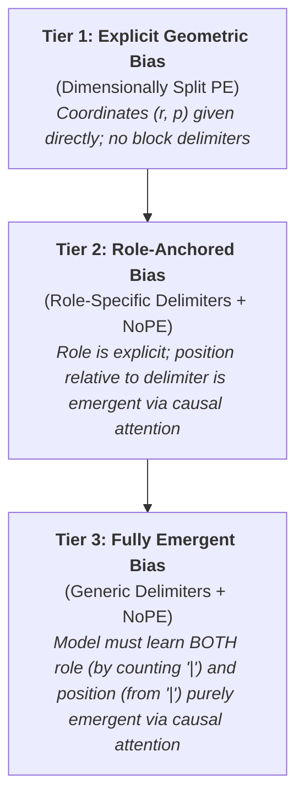

# Experimental Levers: Degrees of Freedom and Design Space

This document enumerates the architectural, representational, and algorithmic **levers** (independent variables) available to configure in TransformAdder. Each lever defines a design dimension with distinct options, theoretical mechanisms, and trade-offs.

The levers are defined separately from the runtime execution paradigms of [`02_mechanics.md`](02_mechanics.md) and most can be combined freely with either the Discrete State Machine (`SM`) or the Continuous Autoregressive Trace (`AR`). They are **not fully orthogonal**; the following couplings are binding:

* **Head configuration (Section 4) is determined by the paradigm**: `SM-MH` uses parallel projection heads; `SM-Seq`, `SM-SeqRev` and `AR` use the tied single-head slice.
* **Prefix-LM masking (Section 6, Option B) is valid only with Tier 1**: without positional encoding, bidirectional attention is permutation-invariant and destroys the axiom's order.

Notation and token display aliases follow [`README.md`](README.md).

---

## 1. Stream Identification & Positional Encoding: The Inductive Bias Spectrum

To execute addition, the model must solve two fundamental binding problems:
1. **Stream Identification (Role)**: Which tokens belong to the axiom, operand $a$, operand $b$, incoming carry, and accumulated output?
2. **Column Alignment (Significance)**: Which digits in $a$ and $b$ correspond to the current addition column, dynamically indexed by output length ($k = |OUT_k|$) in `SM` or by scratchpad column count in `AR`?

We structure this design space as a **3-tier spectrum of inductive bias**, moving from hard-coded architectural coordinates down to fully emergent in-context coordinate tracking, plus two hybrid tiers (4 and 5, Sections 1.4 and 1.5) that decouple role from significance:



**Common to all tiers**: every sequence begins with `[BOS]`; query/trace tokens (`[S]`, `[C]`, `[F]`, `[START]`, `[FINISHED]`) are identical across tiers ([`02_mechanics.md`](02_mechanics.md) Sections 3.1, 4.2). Tiers differ only in (i) whether $(r, p)$ coordinates are supplied and (ii) how the *prompt blocks* are delimited.

---

### 1.1 Tier 1: Dimensionally Split Positional Encoding (Explicit Geometric Bias)
* **Core Philosophy**: Hardcode both role and significance directly into the positional vector. **No block-delimiter tokens exist in the sequence**; the only non-numeral tokens are `[BOS]` and the paradigm's query/trace tokens.
* **Mechanism**: The representation vector $\mathbf{x}_t \in \mathbb{R}^{d_{\text{model}}}$ is explicitly partitioned into orthogonal subspaces:
  $$\mathbf{x}_t = [ \, \mathbf{e}_{b_t} \;\parallel\; \mathbf{p}_t \, ] \in \mathbb{R}^{512}, \quad \text{where } \mathbf{p}_t = [ \, e_{\text{role}}(r_t) \;\parallel\; e_{\text{sig}}(p_t) \, ] \in \mathbb{R}^{256}$$
  * **Role Subspace ($e_{\text{role}} \in \mathbb{R}^{d_{\text{role}}}, \; d_{\text{role}} = 64$)**:
    * Parameterised via a learned embedding lookup table of shape $(8, 64)$ (or fixed orthonormal basis) for roles $r \in \{0, \dots, 7\}$:
      * $r = 0$: `ROLE_AXIOM` (Numeral system definition)
      * $r = 1$: `ROLE_OPERAND_A` (First input number)
      * $r = 2$: `ROLE_OPERAND_B` (Second input number)
      * $r = 3$: `ROLE_CARRY` (Carry digits, and the `[C]` trigger)
      * $r = 4$: `ROLE_OUT` (Sum digits, and the `[S]` query)
      * $r = 5$: `ROLE_FLAG` (The `[F]` flag trigger of `SM-Seq`; flag tokens themselves are never model inputs)
      * $r = 6$: `ROLE_START` (The `[START]` trigger of `AR`)
      * $r = 7$: `ROLE_CTRL` (`[BOS]` and `[PAD]`)
  * **Significance Subspace ($e_{\text{sig}} \in \mathbb{R}^{d_{\text{sig}}}, \; d_{\text{sig}} = 192$)**:
    * For $a, b$: $p=0$ is the least significant digit ($LSD$), $p=1$ is next power, etc.
    * For sum digits: $o_j$ sits at $p = j$, aligned with $a_j$ and $b_j$. The `[S]` query for column $k$ sits at $p = k$.
    * For carry digits: $c_j$ sits at $p = j$, *the index of the column it feeds into*. The `[C]` trigger that elicits $c_{k+1}$ sits at $p = k+1$.
    * For Axiom: $p=0 \dots B-1$ directly encodes the digit's integer value.
    * `[F]`: $p = k$. `[BOS]`, `[START]`, `[PAD]`: $p = 0$.
    * *Length-Invariance Formulation*: To avoid a bounded lookup table overflowing on extrapolation lengths 21–40 (the Positional OOD Confound, see [`05_ablation_variants.md`](05_ablation_variants.md) Section 1), $e_{\text{sig}}(p)$ is parameterised via functional sinusoidal frequencies $\omega_i = 10000^{-2i/192}$ for $i \in \{0, \dots, 95\}$ without a hard length cap.
  * **Subspace Scale Normalisation**: The three input components are each given unit $\ell_2$ norm so that none dominates the first RMSNorm: $\|\mathbf{e}_{b_t}\| = 1$ (one-hot); $e_{\text{sig}}$ is scaled by $1/\sqrt{96}$ (an unscaled 192-dim sinusoid has norm $\sqrt{96} \approx 9.8$ and would shrink the symbol identity to ~1% of the normalised input energy); $e_{\text{role}}$ rows are initialised to unit norm (and held at unit norm if the fixed orthonormal option is used).
* **Known Residual OOD Exposure**: Functional sinusoids remove table overflow, but they do not make unseen coordinates in-distribution. Two combinations are never observed in training and are part of what the experiment tests, not something the encoding guarantees:
  * $(\texttt{ROLE\_AXIOM}, p \in \{10, 11\})$ for Base-12 (training axioms reach at most $p = 9$, although $p \le 19$ is seen in operand roles).
  * $p \in [20, 40]$ in all operand/output/carry roles under length extrapolation.
* **Sequence Representation in Paradigm A (`SM`)**:
  * Input prompt consists of `[BOS]`, raw numerals in LSD-first order, and the terminal `[S]` query. Example at **Step 1** ($k = 1$, after $o_0$ has been accumulated), with coordinates $(r, p)$ beneath:
    $$\underbrace{\texttt{[BOS]}}_{(7,0)} \quad \underbrace{s_0 \; s_1 \; s_2}_{(0,0)\,(0,1)\,(0,2)} \quad \underbrace{a_0 \; a_1}_{(1,0)\,(1,1)} \quad \underbrace{b_0}_{(2,0)} \quad \underbrace{c_1}_{(3,1)} \quad \underbrace{o_0}_{(4,0)} \quad \underbrace{\texttt{[S]}}_{(4,1)}$$
  * At Step 0 the OUT block is empty and the prompt ends $\dots \; c_0^{(3,0)} \; \texttt{[S]}^{(4,0)}$. The column to compute is identically the significance index of the prompt's final token ($k = p_{\text{tail}}$).
  * Model output per iteration is the sum digit, next carry, and flag; for the Step-1 example above, $(o_1, c_2, \text{FLAG}_1)$.
* **Sequence Representation in Paradigm B (`AR`)**:
  * Input prompt prefix consists of `[BOS]`, raw numerals, and `[START]` at $(6, 0)$:
    $$\texttt{[BOS]} \quad \underbrace{s_0 \; s_1 \; s_2}_{\text{Axiom}} \quad \underbrace{a_0 \; a_1}_{\text{Op A}} \quad \underbrace{b_0}_{\text{Op B}} \quad \texttt{[START]}$$
  * Generated scratchpad tokens receive slot-determined coordinates ([`02_mechanics.md`](02_mechanics.md) Section 4.2), identical to the `SM` convention:
    * `[S]` and $o_k$: $(r=4, p=k)$.
    * `[C]` and $c_{k+1}$: $(r=3, p=k+1)$.
    * `[FINISHED]` is terminal and is never embedded as an input.
* **Key Advantages**:
  * Direct inductive bias: the query at $p = k$ matches $a_k$, $b_k$, and $c_k$ all at $p = k$, across both paradigms.
  * Invariant query token: every numeral prediction is read off an `[S]` or `[C]` control token.

---

### 1.2 Tier 2: Role-Anchored Bias (Role-Specific Delimiters + NoPE)
* **Core Philosophy**: Rely on **No Positional Encoding (NoPE)**, using dedicated single-byte delimiter tokens as **in-context spatial landmarks**.
* **Mechanism**:
  * Token input contains zero positional embeddings ($\mathbf{x}_t = [ \, \mathbf{e}_{b_t} \;\parallel\; \mathbf{0}_{256} \, ]$).
  * **Sequence Format in `SM`** (LSD-first, single-byte delimiters from $\mathcal{V}_{\text{ctrl}}$; prompt always terminates on `[S]`):
    - At Step 0 ($|OUT_0|=0$):
      ```text
      [BOS] [AXIOM] 0 1 2 [A] 1 2 [B] 2 [CARRY] 0 [OUT] [S]
      ```
    - At Step 1 (accumulated digits lie between `[OUT]` and `[S]`):
      ```text
      [BOS] [AXIOM] 0 1 2 [A] 1 2 [B] 2 [CARRY] 1 [OUT] 0 [S]
      ```
  * **Sequence Format in `AR`** (LSD-first, harmonised Sum $\to$ Carry grammar):
    ```text
    [BOS] [AXIOM] 0 1 2 [A] 1 2 [B] 2 [START] [S] 0 [C] 1 [S] 0 [C] 1 [S] 1 [C] 0 [FINISHED]
    ```
    *(Operands are LSD-first: $a = [1, 2]$ is the numeral $21_3 = 7_{10}$ and $b = [2]$ is $2_3 = 2_{10}$. Trace for $21_3 + 2_3 = 100_3 = 9_{10}$, yielding LSD sum sequence $[0, 0, 1]$.)*
* **The Learning Hypothesis**:
  1. **Role Identification**: Explicitly provided by the single-byte delimiter token preceding the block (`[AXIOM]`, `[A]`, `[B]`, `[CARRY]`, `[OUT]`).
  2. **Significance via Emergent Causal Offset**: Without positional vectors, self-attention heads must learn to compute column alignment by attending backwards to the enclosing delimiter (e.g. measuring distance from `[A]` or `[B]`). Under causal masking, such counts are derivable from attention over the prefix, anchored by the constant `[BOS]` token.
* **Key Advantages**:
  * **No Positional Table to Overflow**: There are no positional inputs, so *input* representations are identical at every absolute position and nothing is indexed out of range on lengths 21–40. This removes one source of extrapolation failure; it does **not** guarantee length generalisation, because the emergent count signals the model derives internally may themselves drift out of distribution on longer sequences. Whether they do is an empirical question this tier is designed to answer.
  * Uses standard off-the-shelf causal self-attention.

---

### 1.3 Tier 3: Fully Emergent Bias (Generic Delimiters + NoPE)
* **Core Philosophy**: The strongest test of emergent coordinate representation. Uses **No Positional Encoding (NoPE)** with a **single, neutral block delimiter** (`DELIM_GENERIC`, illustrated as `|`):
  * **Sequence Format in `SM`** (prompt always terminates on `[S]`):
    - At Step 0 ($|OUT_0|=0$): the 4th delimiter `|` opens the (empty) OUT block:
      ```text
      [BOS] 0 1 2 | 1 2 | 2 | 0 | [S]
      ```
    - At Step 1:
      ```text
      [BOS] 0 1 2 | 1 2 | 2 | 1 | 0 [S]
      ```
  * **Sequence Format in `AR`** (the trace grammar is identical to Tiers 1 and 2; only the prompt delimiting differs):
    ```text
    [BOS] 0 1 2 | 1 2 | 2 [START] [S] 0 [C] 1 [S] 0 [C] 1 [S] 1 [C] 0 [FINISHED]
    ```
* **Scope of "Generic"**: Genericity applies to the *prompt block structure* (axiom / $a$ / $b$ / carry / OUT), which is where role must be inferred by delimiter counting. The query and trace tokens (`[S]`, `[C]`, `[F]`, `[START]`) remain dedicated tokens in all tiers, so that one trace grammar, one parser, and one harness serve every tier.
* **The Dual Learning Hypothesis**:
  1. **Role Identification via Delimiter Counting**: Early attention layers learn a cumulative counter circuit that determines stream role strictly from the number of preceding `|` delimiters.
  2. **Significance via Relative Offset**: Attention heads simultaneously measure distance/offset from the nearest `|` boundary to determine column significance $k$.
* **Key Advantages**:
  * Minimal vocabulary overhead (1 block separator replaces 5 role delimiters).
  * Purest test of whether a vanilla transformer can spontaneously synthesise its own structured multi-stream coordinate system from scratch.

---

### 1.4 Tier 4: Hybrid Scope Bias (Generic Delimiters + Role Embeddings)
* **Core Philosophy**: Supply **role** explicitly but leave **significance** emergent. Token layout is identical to Tier 3 (single neutral delimiter `|`); every token additionally carries the learned Tier 1 role embedding $e_{\text{role}}(r_t) \in \mathbb{R}^{64}$, while the 192-dim significance subspace is zero:
  $$\mathbf{x}_t = [ \, \mathbf{e}_{b_t} \;\parallel\; e_{\text{role}}(r_t) \;\parallel\; \mathbf{0}_{192} \, ]$$
* **Role Assignment**: As in Tier 1 for axiom, operand, carry, OUT, query and trace tokens; `[BOS]` and every `|` delimiter take `ROLE_CTRL`.
* **Sequence Formats**: Identical to Tier 3 in both `SM` and `AR`.
* **The Learning Hypothesis**: With role given, `|` need not be counted; it serves as a single shared anchor from which attention measures the column offset $k$.

---

### 1.5 Tier 5: Decoupled Bias (Dual Delimiters `[ROLE] [ORIGIN]` + NoPE)
* **Core Philosophy**: **NoPE** as in Tier 2, but every role delimiter is followed by the shared zero-origin anchor `[ORIGIN]` (`DELIM_ORIGIN`), decoupling scope (which block) from origin (where offset 0 is):
  * **Sequence Format in `SM`**:
    ```text
    [BOS] [AXIOM] [ORIGIN] 0 1 2 [A] [ORIGIN] 1 2 [B] [ORIGIN] 2 [CARRY] [ORIGIN] 1 [OUT] [ORIGIN] 0 [S]
    ```
  * **Sequence Format in `AR`** (trace grammar unchanged):
    ```text
    [BOS] [AXIOM] [ORIGIN] 0 1 2 [A] [ORIGIN] 1 2 [B] [ORIGIN] 2 [START] [S] 0 [C] 1 [S] 0 [C] 1 [S] 1 [C] 0 [FINISHED]
    ```
* **The Learning Hypothesis**: Role is read off the role delimiter; significance is measured as the offset from `[ORIGIN]`. Because `[ORIGIN]` is the same token in every block, a single shared column counter suffices, instead of one per role delimiter as in Tier 2.

---

### 1.6 Pinned Design Decision: LSD-First (LSB-First) Directionality
* **Core Philosophy**: All operands ($a$, $b$, and accumulated $OUT$) are formatted strictly in **algorithmic reading order ($LSD \to MSD$)**, placing the least-significant digit at local offset 0.
* **Theoretical Rationale**:
  * In conventional reading order ($MSD \to LSD$), column $k$ sits at index $\text{len}(\text{op}) - 1 - k$. Locating column $k$ requires first measuring total operand length and computing a reverse offset, introducing a length-dependent confounding difficulty unrelated to addition itself.
  * In LSD-first order, column $k$ is **invariantly located at offset $+k$ from the block's origin**, regardless of whether the number has 2 digits or 50 digits.

---

## 2. Vocabulary & Symbol Representation (1-Byte Identity Space)

The vocabulary is defined directly as the **complete 1-byte spectrum**:
$$|\mathcal{V}| = 256 \quad (\texttt{0x00} \dots \texttt{0xFF})$$

### 2.1 Mechanics & Vocabulary Partitioning

> [!IMPORTANT]
> This section is the **single source of truth** for byte assignments. No other document restates the table.

* **Direct Byte Identity**: A problem instance *is* a sequence of byte integers $b \in \{0, \dots, 255\}$, constructed directly by the data generator; token indices are exactly the byte values. There is no text string, no character encoding (ASCII/UTF-8) step, no BPE merging, no custom token dictionary, and zero Out-of-Vocabulary (OOV) risk for novel bases. Bytes are rendered as text only for display.
* **Vocabulary Partitioning**:
  * **Numeral Symbol Pool ($\Sigma = \mathcal{V} \setminus \mathcal{V}_{\text{ctrl}}$)**: Byte range `0x00`–`0xEF` (exactly 240 symbols). In each problem instance, $B$ distinct bytes are sampled uniformly from $\Sigma$, in random order, to form the axiom $\mathcal{A}$. Every byte of $\Sigma$ is therefore seen in training, at every value position (see [`01_research_goal.md`](01_research_goal.md) Section 2.1).
  * **Control & Delimiter Tokens ($\mathcal{V}_{\text{ctrl}} \subset \mathcal{V}$)**: High-range single bytes (`0xF0`–`0xFF`) dedicated to structural markup, preserving the **1-byte = 1-token invariant**:

    | Byte | Canonical Name | Alias | Purpose |
    | :--- | :--- | :--- | :--- |
    | `0xF0` | `DELIM_AXIOM` | `[AXIOM]` | Tier 2/5 axiom block delimiter |
    | `0xF1` | `DELIM_A` | `[A]` | Tier 2/5 operand A delimiter |
    | `0xF2` | `DELIM_B` | `[B]` | Tier 2/5 operand B delimiter |
    | `0xF3` | `DELIM_CARRY` | `[CARRY]` | Tier 2/5 carry delimiter (`SM` only) |
    | `0xF4` | `DELIM_OUT` | `[OUT]` | Tier 2/5 output delimiter (`SM` only) |
    | `0xF5` | `START` | `[START]` | `AR` trace trigger |
    | `0xF6` | `TOKEN_S` | `[S]` | Sum query: `SM` prompt tail / `SM-SeqRev` Pass 2 trigger / `AR` sum marker |
    | `0xF7` | `TOKEN_C` | `[C]` | Carry query: `SM-Seq` Pass 2 trigger / `SM-SeqRev` prompt tail / `AR` carry marker |
    | `0xF8` | `FLAG_CONTINUE` | `[CONTINUE]` | Loop continuation flag (`SM` only) |
    | `0xF9` | `FLAG_FINISHED` | `[FINISHED]` | Loop termination flag (`SM`) / trace terminator (`AR`) |
    | `0xFA` | `DELIM_ORIGIN` | `[ORIGIN]` | Tier 5 zero-origin spatial anchor |
    | `0xFB` | `DELIM_GENERIC` | `\|` | Tier 3/4 neutral block delimiter |
    | `0xFC` | `TOKEN_FLAG` | `[F]` | `SM-Seq` / `SM-SeqRev` Pass 3 flag trigger |
    | `0xFD` | `PAD` | `[PAD]` | Batch padding (right-padding only; never attended by real tokens, loss-masked) |
    | `0xFE` | `BOS` | `[BOS]` | Sequence origin; attention sink and NoPE count anchor |
    | `0xFF` | — | — | Reserved |

---

## 3. Token Embedding & Subspace Allocation

How raw byte tokens ($b \in \{0, \dots, 255\}$) are converted into vector representations before the first transformer layer:

* **Fixed One-Hot Representation**: Each byte value $b$ is represented by a fixed, non-trainable 256-dimensional one-hot vector:
  $$\mathbf{e}_b \in \{0, 1\}^{256}$$
* **Canonical Subspace Allocation ($d_{\text{model}} = 512$)**:
  * The representation space is strictly partitioned into two orthogonal 256-dimensional blocks:
    $$\mathbf{x}_t = [ \, \mathbf{e}_{b_t} \;\parallel\; \mathbf{p}_t \, ] \in \mathbb{R}^{512}$$
    - **Dimensions $0 \dots 255$ (Symbol Identity)**: At the input, strictly contains the fixed one-hot byte vector $\mathbf{e}_{b_t}$, uncorrupted by positional encodings.
    - **Dimensions $256 \dots 511$ (Positional & Algorithmic State)**: Holds positional vectors $\mathbf{p}_t = [e_{\text{role}}(r_t) \parallel e_{\text{sig}}(p_t)]$ in Tier 1. In Tier 4 only the role part is populated ($[e_{\text{role}}(r_t) \parallel \mathbf{0}_{192}]$). In Tiers 2, 3 and 5 (NoPE), these dimensions are initialised to zero ($\mathbf{0}_{256}$), serving as dedicated working memory for attention heads and MLPs.
* **Theoretical Purpose**:
  * **No learned embedding table**: there is no trainable per-token vector in which a symbol's "meaning" could be stored at the input. This does *not* by itself prevent memorisation: the first-layer projections ($W_Q, W_K, W_V$, FFN input) read the one-hot block and can still learn per-byte associations. What removes the *incentive* to do so is per-instance random symbol sampling (Section 2.1), under which no byte has a stable value.
  * Guarantees that the tied copy slice (Section 4.1) reads from a subspace with a fixed, known symbol basis.
  * Together with uniform sampling over all of $\Sigma$, addresses the Untrained Embedding Confound ([`05_ablation_variants.md`](05_ablation_variants.md) Section 1): every byte's one-hot column receives gradient during training, so Base-12 evaluation never touches untrained parameters. A fixed one-hot basis alone would not achieve this; a byte never sampled in training would still meet untrained first-layer weights.

---

## 4. Output Decoding & Emission: Head Architectures & Circuits

The model must emit two distinct categories of tokens:
1. **Axiom-Derived Numerals** ($o_k$ and $c_{k+1}$): Must be copied dynamically from the in-context axiom $\mathcal{A}$.
2. **Control Tokens** (`FLAG_CONTINUE`, `FLAG_FINISHED`; in `AR` also `[S]` and `[C]`): Emitted from internal algorithmic state.

### 4.1 Axiom Copy Circuit (Tied Identity Unembedding)
* **Implementation**: The unembedding is a weight-free slice of the final-normalised residual stream onto the one-hot input basis. The final norm is **gain-free** ($\text{RMSNorm}_0$, no learnable scale), so the output path contains zero trainable parameters:
  $$\mathbf{y}_t = \text{RMSNorm}_0(\mathbf{h}_t)[:256] \in \mathbb{R}^{256}$$
  This is the single canonical definition; all other documents refer to it as the *tied copy slice*.
* **Hypothesised In-Model Copy Mechanism** (a hypothesis to be verified by interpretability, not an architectural guarantee):
  1. In a late attention layer, one or more **copy heads** match the computed sum/carry index to the prompt's active axiom $\mathcal{A}$ and move the selected symbol's one-hot identity into dims $0 \dots 255$ of the query position.
  2. **Rank constraint**: a single head has $d_{\text{head}} = 64$, so its $W_V W_O$ circuit has rank $\le 64$ and *cannot* realise an identity map on the 256-dimensional symbol subspace. An exact copy requires $\ge 4$ heads attending to the same axiom position with complementary value subspaces; alternatively the model may use a low-rank approximate copy that merely makes the correct byte the $\arg\max$. Which solution is learned is an open empirical question.
  3. **Self-identity cancellation**: the residual stream at position $t$ already contains the input token's own one-hot $\mathbf{e}_{b_t}$ in dims $0 \dots 255$. Under the tied slice this is a standing logit bias towards re-emitting the input token, which the model must learn to cancel or out-vote. For numeral predictions the input token is always a control token (`[S]` or `[C]`), so the bias never competes with another numeral; in `AR`, control-token predictions made from numeral positions (e.g. `[C]` after $o_k$) must overcome it.

### 4.2 Control Token Emission
* In single-head decoders (`SM-Seq`, `AR`), control tokens are emitted through the same tied copy slice: the model writes onto the corresponding control byte dimension (e.g. `0xF8`, `0xF9`) of the symbol subspace.
* In `SM-MH`, the flag is emitted by the dedicated 2-way `head_flag`; no control byte is ever decoded from a 256-way head.

### 4.3 Head Configurations Across Runtime Paradigms

The head topology is fixed by the paradigm (it is not an independent lever):

#### Configuration 1: Multi-Head Parallel Output (`SM-MH`)
* **Scope**: Exclusively used in Paradigm A1 (`SM-MH`).
* **Architecture**: Because sum, carry, and flag must be decoded simultaneously from the single hidden state at the `[S]` query position, $\mathbf{h}_T \in \mathbb{R}^{512}$, the representation is passed through a (standard, gained) RMSNorm and three dedicated parallel heads:
  1. `head_sum`: Learned linear projection ($W_{\text{sum}}: \mathbb{R}^{512} \to \mathbb{R}^{256}$) emitting logits for $o_k$.
  2. `head_carry`: Learned linear projection ($W_{\text{carry}}: \mathbb{R}^{512} \to \mathbb{R}^{256}$) emitting logits for $c_{k+1}$.
  3. `head_flag`: Binary linear probe ($W_{\text{flag}}: \mathbb{R}^{512} \to \mathbb{R}^2$) emitting logits for $\text{FLAG}_k$.
* **Generalisation Caveat**: Learned 256-way heads carry per-byte output weights. These are all trained (every byte of $\Sigma$ appears as a target under uniform sampling), but unlike the tied slice they are not symbol-agnostic by construction.
* **Copy-Preserving Alternative (ablation, see [`05_ablation_variants.md`](05_ablation_variants.md))**: In place of learned linear projections, `SM-MH` can deploy dual in-context copy heads, where two distinct query projections attend across $\mathcal{A}$ to retrieve one-hot symbol representations without learned token logits. Not part of the primary matrix.
* **Computational Trade-off**: $3\times$ fewer forward passes per column, at the cost of dedicated trainable output projections.

#### Configuration 2: Unified Single-Head Decoder (`SM-Seq`, `SM-SeqRev` and `AR`)
* **Scope**: Used in Paradigms A2 (`SM-Seq`), A3 (`SM-SeqRev`) and Paradigm B (`AR`).
* **Architecture**: The single tied copy slice of Section 4.1: dimensions $0 \dots 255$ serve numerals and control bytes alike.
* **Mechanism in `SM-Seq`**: The model sequentially unrolls $o_k \to c_{k+1} \to \text{FLAG}_k$ across 3 autoregressive forward steps before the harness flushes transient tokens.
* **Mechanism in `SM-SeqRev`**: As `SM-Seq`, in carry-first order $c_{k+1} \to o_k \to \text{FLAG}_k$.
* **Mechanism in `AR`**: The model rolls out intermediate scratchpad tokens continuously in harmonised order ($\texttt{[S]} \, o_k \, \texttt{[C]} \, c_{k+1}$) until `[FINISHED]`.
* **Computational Trade-off**: Standard transformer architecture with no output parameters at all.

---

## 5. Model Depth ($N_{\text{layers}}$)

How many transformer layers are required to compute one step of the addition state transition?

### 5.1 Algorithmic Circuit Decomposition
Executing one column transition requires the following sub-operations. Steps 0 and 3 depend only on the prompt structure and can run in parallel with Steps 1–2; Step 6 depends on the result of Step 4.

0. **Step 0: Structural Indexing**: Determining the current column $k$ and each prompt token's offset within its block. Free in Tier 1 (coordinates are given); in NoPE tiers this must itself be computed by attention (counting tokens since a delimiter), consuming depth before any alignment can occur.
1. **Step 1: Column Alignment (Querying $a_k$, $b_k$, $c_k$)**: Attending to offset $k$ in operands $a$ and $b$, *or detecting that no digit exists there* (value 0, [`02_mechanics.md`](02_mechanics.md) Section 2, invariant 3), and retrieving the carry $c_k$.
2. **Step 2: Axiom Value Lookup (De-symbolisation)**: Attending from symbols $a_k, b_k, c_k$ to their matching entries in $\mathcal{A}$ to retrieve integer values $v_a, v_b, v_c \in \{0, \dots, B-1\}$ (the matched entry's axiom offset).
3. **Step 3: Base Determination**: Retrieving $B = |\mathcal{A}|$ (the axiom length), without which neither the carry threshold nor the modulus is defined. This is the step that distinguishes a base-general algorithm from a per-base lookup.
4. **Step 4: Arithmetic & Carry Logic**: Computing $v = v_a + v_b + v_c$, $c_{\text{out}} = [v \ge B]$, and $s_{\text{out}} = v - B \cdot c_{\text{out}}$ inside the FFN. (Since $v \le 2B - 1$, the carry is a single threshold and the modulus a single conditional subtraction.)
5. **Step 5: Axiom Symbol Retrieval (Re-symbolisation)**: Attending back to offsets $s_{\text{out}}$ and $c_{\text{out}}$ in $\mathcal{A}$ to copy the output bytes into the residual stream.
6. **Step 6: Halting Logic**: Detecting operand exhaustion (no digit exists at offset $k+1$ in either operand, i.e. $k \ge \max(|a|,|b|) - 1$) and combining it with $c_{\text{out}} = 0$ to select `FLAG_FINISHED`.

### 5.2 Depth Exploration Range
* **$N = 3$ Layers (Conjectured Minimum, Tier 1)**: A plausible minimal allocation for standard Attention-then-FFN blocks with coordinates supplied. This is a design conjecture, not a proven lower bound:
  - Layer 1: Attends to operands and carry (Step 1); axiom length retrieval (Step 3).
  - Layer 2: De-symbolisation attention (Step 2); FFN computes $s_{\text{out}}$, $c_{\text{out}}$ and the halting predicate (Steps 4, 6).
  - Layer 3: Attention conditioned on FFN arithmetic output attends back to $\mathcal{A}$ to copy the output numeral into the residual stream (Step 5).
  NoPE tiers must additionally perform Step 0 and are expected to need at least one further layer.
* **$N = 2$ Layers (Aggressive Compression Test)**: Probes whether Steps 1 and 2 can collapse into a single layer, e.g. under Tier-1 Prefix-LM visibility (Section 6) where operand tokens can pre-compute their own values.
* **$N = 4$ Layers**: Roughly one layer per sequential step.
* **$N = 6$ Layers (Default Baseline)**: Ample algorithmic depth with safety margin.
* **$N = 8$ Layers**: Depth control testing for overparameterisation.

### 5.3 Reference Architecture Hyperparameters

| Hyperparameter | Symbol | Baseline Value | Notes |
| :--- | :--- | :--- | :--- |
| Model Dimension | $d_{\text{model}}$ | 512 | Partitioned: $256$ (Symbol) + $256$ (Pos/State) |
| Attention Heads | $n_{\text{heads}}$ | 8 | Standard multi-head self-attention |
| Head Dimension | $d_{\text{head}}$ | 64 | $d_{\text{head}} = d_{\text{model}} / n_{\text{heads}}$; bounds per-head copy rank (Section 4.1) |
| FFN Hidden Dimension | $d_{\text{ffn}}$ | 1376 (SwiGLU) / 2048 (GeLU) | $\approx \frac{8}{3} d_{\text{model}}$ rounded up to a multiple of 32 for SwiGLU; $4 d_{\text{model}}$ for GeLU (parameter-matched) |
| Normalisation | Norm | RMSNorm (Pre-LN) | Learnable gain in blocks; **gain-free** final norm before the tied slice |
| Unembedding Slicing | $\mathbf{y}_t$ | $\text{RMSNorm}_0(\mathbf{h}_t)[:256]$ | Tied copy slice (Section 4.1); `SM-MH` uses learned heads instead |
| Loss Masking | $\mathcal{L}$ | Model-emitted tokens only | Prompt tokens, harness-inserted triggers, and padding have loss weight 0 (see [`06_implementation.md`](06_implementation.md) Section 4) |

---

## 6. Attention Visibility Regime: Strict Causal vs. Prefix-LM

* **Option A: Strict Full Causal Masking (Default Baseline; all tiers)**: Standard lower-triangular causal attention mask. Causal accumulation is what makes emergent counting possible in Tiers 2 & 3 with NoPE.
* **Option B: Prefix-LM Masking (Tier 1 only; ablation)**: Bidirectional attention within the static problem prefix $(\texttt{[BOS]}, \mathcal{A}, a, b)$; all subsequent tokens (in `SM`: $c_k$, $OUT_k$, `[S]` and transients; in `AR`: `[START]` and the trace) attend causally. Tests whether mutual visibility in the prefix reduces the depth threshold ($N_{\text{layers}}$).
  * **Invalid under NoPE**: self-attention without positional inputs is permutation-equivariant; a bidirectional prefix is then an unordered *bag* of tokens, and the axiom's order, which is its entire semantic content, becomes unrecoverable. Option B is therefore defined only for Tier 1, where order is carried by explicit coordinates.

---

## 7. Feed-Forward Non-Linearity: The Modulo & Carry Engine

* **Option A: SwiGLU / Bilinear Gated MLP (Primary)**:
  $$\text{FFN}(\mathbf{x}) = \left(\text{Swish}(\mathbf{x} W_{\text{gate}}) \odot (\mathbf{x} W_{\text{up}})\right) W_{\text{down}}$$
  Multiplicative gating is hypothesised to suit the threshold step for carries ($[v \ge B]$) and the conditional subtraction for the sum digit ($v - B \cdot c_{\text{out}}$), since the gate can condition one quantity on a comparison involving another.
* **Option B: Standard GeLU MLP (Baseline)**: Two-layer linear projection with GeLU non-linearity.

---

## 8. Training Base Cardinality Diversity

* **Option A: Minimal Bimodal Regime ($\mathcal{B}_{\text{train}} = \{2, 10\}$)**: Tests whether two bases suffice to induce an abstract algorithm.
* **Option B: Multimodal Diverse Regime ($\mathcal{B}_{\text{train}} = \{2, 4, 8, 10\}$)**: Mitigates the Binary-Switch Confound ([`05_ablation_variants.md`](05_ablation_variants.md) Section 1) by making a per-base switch between memorised routines more costly than computing the threshold from $|\mathcal{A}|$. It does not eliminate the possibility of a 4-way switch; Base-3 and Base-12 evaluation is what discriminates the two.
